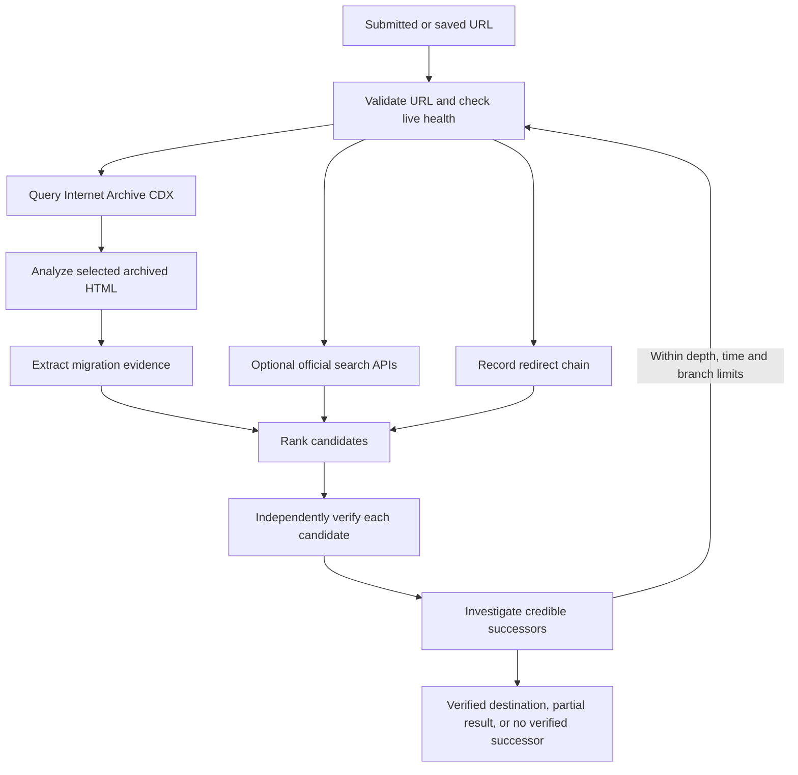

<div align="center">

# LinkResurrector

**Find the current successor of a dead link—with a visible migration trail and evidence.**


LinkResurrector is a Chrome and Brave extension with an on-device recovery engine. It follows credible website migrations across generations, checks each candidate, and distinguishes a verified live successor from an archived snapshot or an unverified suggestion.

</div>

## Contents

- [What it does](#what-it-does)
- [How recovery works](#how-recovery-works)
- [Security model](#security-model)
- [Install and run](#install-and-run)
- [Configure optional search](#configure-optional-search)
- [Use the extension](#use-the-extension)
- [Development and tests](#development-and-tests)
- [Known limits](#known-limits)
- [Project map](#project-map)

## What it does

- Saves the current tab to a browser-profile vault and checks it immediately.
- Rechecks saved links every 30 minutes when Link Monitoring is enabled.
- Groups links under Work, Entertainment, Learning, Personal, Other, or Uncategorized, with the actual saved date.
- Checks HTTP status and redirect chains, including common “HTTP 200 but page is gone” and parked-domain cases.
- Uses Internet Archive CDX captures as historical evidence, not as proof of a current destination.
- Extracts migration announcements and metadata, optionally searches official provider APIs, and independently verifies candidates.
- Follows credible successors through bounded generations and checks a limited number of alternative branches.
- Shows the original URL, migration chain, candidates, evidence, confidence heuristic, uncertainty, and historical Wayback fallback separately.
- Opens a saved link’s successor only after the engine has marked it verified.

Recovery runs on the computer through Chrome Native Messaging. The extension does not call a localhost service and the helper does not listen on a network port.

## How recovery works



Every confidence score is a heuristic, not a probability. A candidate may be a historical lead without being a verified successor. A recovered website does not automatically mean the exact original article or deep link was recovered.

## Security model

The engine accepts arbitrary URLs, so outbound requests are treated as an SSRF boundary. These protections are implemented in the current source; they reduce risk but do not amount to a guarantee of perfect security or an independent security certification.

| Risk | Implemented control | Where |
|---|---|---|
| Unsafe URL schemes or embedded credentials | Accepts only HTTP and HTTPS; rejects malformed hosts and URLs containing username/password credentials. | `server/src/util/url.js`, `server/native-host.js` |
| SSRF to local or private networks | Resolves DNS and rejects unsafe addresses, including loopback, private IPv4, link-local, metadata, CGNAT, multicast/reserved ranges, and private IPv6 forms. Unparseable addresses fail closed. | `server/src/security/ssrf.js`, `server/src/util/ip.js` |
| DNS rebinding | Checks resolved addresses before a request and validates them again through the socket’s DNS lookup immediately before connection. The validated address list is passed to the HTTP client. | `server/src/security/ssrf.js` |
| Redirect-based SSRF | Redirects are followed manually. Every hop is parsed and validated again; unsafe schemes and credentials are rejected; loops and excessive hops stop. | `server/src/security/ssrf.js` |
| Credentials crossing a redirect | Authorization, cookie, API-key, token, secret, and subscription-key headers are stripped when a redirect changes origin. | `server/src/security/ssrf.js` |
| Slow or oversized responses | Each fetch has a timeout and a maximum response-body size. Defaults are 12 seconds and 512 KiB; redirects are capped at 8. TLS certificate verification uses Node’s normal HTTPS defaults. | `server/src/config.js`, `server/src/security/ssrf.js` |
| Executing untrusted page content | Retrieved HTML is treated as inert text for metadata extraction. The app does not evaluate scripts or execute downloaded files; React renders text through normal escaped bindings. | `server/src/util/html.js`, `src/` UI components |
| Untrusted extension-to-helper messages | Native Messaging frames are length-checked and capped at 1 MiB. Request IDs, URL length, protocol, title, and progress fields are bounded or validated. stdout is reserved for protocol frames; logs go to stderr. | `server/src/nativeProtocol.js`, `server/native-host.js` |
| Other extensions invoking the helper | Installer registration allowlists the exact Chrome extension ID supplied during installation. The helper is launched through the browser’s Native Messaging mechanism. | `server/install-native-host.*`, `server/native-host.js` |
| Concurrent recovery resource use | A per-user lock bounds recovery across helper processes; abandoned locks are considered stale only after the owner process is gone and the lock is old. The development API also caps active jobs. | `server/native-host.js`, `server/src/jobs/jobStore.js` |
| API abuse and cross-origin requests | The optional development API binds only to loopback, rejects non-allowlisted `Origin` values, reflects only an exact configured/valid extension origin, caps JSON bodies at 16 KiB, and rate-limits by the socket address. It ignores caller-supplied `X-Forwarded-For`. | `server/index.js`, `server/src/api/routes.js`, `server/src/config.js` |
| Secrets in source or extension bundle | Search keys are read from environment variables or a user `.env` file, never bundled in the extension. Unix config files are restricted to owner read/write permissions when loaded. | `server/src/config.js`, `server/.env.example` |

### Security boundary and privacy notes

- The extension requests only `storage`, `alarms`, `activeTab`, and `nativeMessaging`; it does not ask for broad all-sites browser interception.
- Link data is kept in `chrome.storage.local` for the current browser profile. The extension does not encrypt that data itself or sync it to another computer.
- The optional HTTP API has no user-login system. It is restricted to loopback for development and is not intended to be exposed as a public service. CORS is not authentication.
- Optional search requests send title/description-derived queries to the configured provider. Provider accounts, terms, quotas, and privacy policies still apply.
- Search credentials are stored in the user’s local config file if configured. They are not held in an OS keychain by this release.
- Candidate scoring and page identity checks are heuristics. A score is not proof that a domain is officially owned by the original site.

The test suite includes deterministic checks for private IPv4/IPv6, DNS rebinding, redirect-to-private attacks, redirect credential stripping, body/time limits, malformed URLs and HTML, candidate impersonation, parked pages, and native-host message validation. `npm audit` checks package advisories; neither automated tests nor a clean dependency audit replace a professional security review.

## Install and run

### Requirements

- Chrome or Brave.
- Node.js 18 or newer on each computer where recovery should run.
- The LinkResurrector project folder (or a packaged extension build).

### 1. Build and load the extension

From the project folder:

```bash
npm ci
npm run build
```

Open `chrome://extensions` (Brave: `brave://extensions`), enable **Developer mode**, choose **Load unpacked**, and select the project’s `dist/` folder. The installed extension displays version **1.0.0**.

### 2. Install the native helper

On the browser extensions page, copy LinkResurrector’s extension ID. Run the installer for your operating system from the project folder, replacing `YOUR_EXTENSION_ID` with that exact ID:

**macOS**

```bash
bash server/install-native-host.sh YOUR_EXTENSION_ID
```

**Linux**

```bash
bash server/install-native-host-linux.sh YOUR_EXTENSION_ID
```

**Windows PowerShell**

```powershell
powershell -ExecutionPolicy Bypass -File server/install-native-host.ps1 YOUR_EXTENSION_ID
```

Restart Chrome or Brave. In the dashboard’s **Resurrector** section, confirm the status says **On-device helper connected**. Each computer needs its own helper installation. For a locally loaded extension, reinstall the helper if the extension ID changes. A published extension normally keeps a stable store ID.

## Configure optional search

Search credentials are optional. Without them, the engine still checks live redirects and Wayback history and reports **reduced** search coverage.

| Provider | Variables |
|---|---|
| Bing Web Search API | `BING_API_KEY` |
| Google Custom Search API | `GOOGLE_API_KEY`, `GOOGLE_CSE_ID` |

The installer places `.env.example` next to the installed helper. Copy it to `.env` in that same parent folder and add your keys. The helper reads the file on startup; existing system environment variables take precedence. Restart the browser after changing configuration.

| Operating system | Config folder |
|---|---|
| macOS | `~/Library/Application Support/LinkResurrector/` |
| Linux | `~/.local/share/linkresurrector/` |
| Windows | `%LOCALAPPDATA%\LinkResurrector\` |

Do not commit `.env`, paste keys into extension source, or share the config file.

## Use the extension

1. Click the LinkResurrector toolbar icon.
2. Select a category and choose **Save Current Tab**. The URL is added to the local vault and a check starts immediately.
3. Open **Full Dashboard** to see **All Links**, category groups, save dates, statuses, and recovery evidence.
4. Keep **Link Monitoring** enabled for the 30-minute check schedule, or use **Check All Now**.

Saved links persist across browser restarts in that browser profile. They do not sync between computers. The helper runs only when requested by the extension; it does not continuously browse or crawl websites. Successor switching applies when opening links from the vault; it does not intercept every navigation in Chrome.

## Development and tests

Start the UI preview:

```bash
npm run dev
```

The preview is for UI work. Chrome storage and Native Messaging are available only when the built extension is loaded in Chrome/Brave.

Start the separate development API only when needed:

```bash
node server/index.js
```

It binds to loopback, refuses non-loopback `HOST` values, and is not used by the extension. For project-local environment settings, copy `server/.env.example` to `server/.env`.

Run checks from the project root:

```bash
npm test                         # frontend/native client tests
npm run test:engine               # recovery, API, native-host and security tests
npm run build                     # production extension build
npm audit --audit-level=moderate  # dependency advisory check
```

At the latest verification for this source tree, the frontend suite passed 4 tests, the engine suite passed 102 tests, the production build succeeded, and `npm audit` reported 0 vulnerabilities. The macOS and Linux installer scripts were smoke-checked with temporary user folders; the Windows installer was not executed in this environment.

## Defaults and limits

| Setting | Default |
|---|---:|
| Successor depth | 4 generations beyond the submitted URL |
| Total investigation budget | 90 seconds |
| Candidates checked per generation | 6 |
| Alternative branches | 3 |
| Per-request timeout | 12 seconds |
| Response body cap | 512 KiB |
| HTTP redirects followed | 8 |
| Development API body cap | 16 KiB |
| Development API active jobs | 2 |

The engine may stop early when a provider is unavailable, rate-limited, or the configured budget is reached. It reports those conditions rather than inventing a destination. Exact page recovery is **not implemented as a general page-matching crawler** in this release: a verified successor website can be identified while the exact original deep page remains unconfirmed. Recovery jobs and caches are process-local; the saved link vault itself persists in Chrome storage.

## Project map

| Path | Responsibility |
|---|---|
| `src/popup/` | Toolbar popup and save-current-tab flow |
| `src/dashboard/` | Vault, categories, result evidence, and About/security view |
| `src/services/linkService.js` | Persistent local vault and recovery result mapping |
| `src/services/backend.js` | Native Messaging client used by the extension |
| `src/background.js` | 30-minute monitoring alarm and saved-link recovery |
| `server/native-host.js` | Chrome Native Messaging entry point |
| `server/src/security/ssrf.js` | Safe HTTP requests and redirect validation |
| `server/src/core/` | Health, evidence, verification, scoring, and migration orchestration |
| `server/src/providers/` | Internet Archive CDX and optional search APIs |
| `server/src/api/` | Optional loopback development API |
| `server/install-native-host.*` | Per-user helper installation and browser registration |

More architecture and limitation details are in [`ARCHITECTURE.md`](ARCHITECTURE.md). The development API is described in [`server/README.md`](server/README.md); settings are listed in [`server/.env.example`](server/.env.example).
